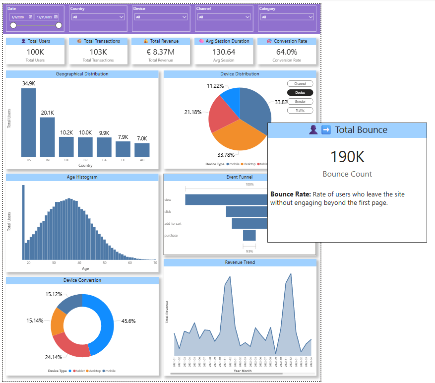

# A/B Testing Analysis - E-commerce Dataset

This project analyzes an A/B testing experiment using e-commerce data to evaluate the impact of different variants on user conversion. It includes a Power BI dashboard for the wider e-commerce context.

---

## 📊 Project Overview

The analysis compares Control, Variant_A, and Variant_B groups to determine whether the new variants improve the conversion rate.

- **Dataset:** Kaggle "Marketing & E-Commerce Analytics Dataset" (about 100K users)
- **Question:** Do Variant_A or Variant_B convert better than Control?
- **Metric:** User-level conversion rate (a user converts if they have at least one transaction)

---

## 🧠 Key Steps

- Data ingestion using Kaggle API
- Data cleaning and transformation
- User-level dataset creation
- Conversion rate calculation
- Lift analysis
- Statistical testing (two-proportion Z-test)
- Business interpretation

---

## ⚙️ Data Processing Approach

Event-level data was aggregated to user level, so that:

- Each user belongs to a single experiment group
- Conversion reflects user-level behavior, not event-level behavior

Users can have events under more than one experiment label. Each user is assigned the **first experiment group seen in the events table**, and the user table is validated (one row per user).

**Correction note:** `02_ecommerce_ab_testing_analysis.ipynb` is the first attempt. It picked the most frequent group per event, which produced a heavily unbalanced split (Control 96,394 vs about 1,800 per variant). `03_ab_testing_user_level_fix.ipynb` fixes the assignment and gives a balanced split (Control 60,015, Variant_A 20,067, Variant_B 19,918). All results below use the corrected user-level table.

---

## 📈 Results (user-level data)

| Group | Users | Conversion rate | Lift vs Control | p-value (Z-test) |
|---|---|---|---|---|
| Control | 60,015 | XX.X% | - | - |
| Variant_A | 20,067 | XX.X% | X.X% | 0.XXX |
| Variant_B | 19,918 | XX.X% | X.X% | 0.XXX |

---

## 🚨 Conclusion

- (If p > 0.05) No strong evidence that the variants change conversion. Observed differences may be due to random variation. **Recommendation:** do not roll out the variants.
- (If p < 0.05) The variant shows a statistically significant difference. **Recommendation:** decide the rollout based on the lift and its direction.

---

## ⚠️ Limitations

- Conversion means "at least one transaction", with no time window after the user saw the experiment. Purchases before the test could count as conversions.
- Two variants are compared with Control, so p-values are not adjusted for multiple comparisons.
- Users with events under several experiment labels are assigned by first appearance, which is a simplification.

---

## 📊 Dashboard

A Power BI dashboard summarizes the e-commerce dataset: users, transactions, revenue, session duration, conversion rate, geography, devices, age, event funnel, and revenue trend.

Full export: [`Dashboard.pdf`](Dashboard.pdf)

---

## 💡 Next Steps

- Test stronger variations
- Increase sample size
- Add a time window and an exposure date to the conversion definition
- Run additional experiments

---

## ⚙️ Tech Stack

- Python (Pandas, NumPy)
- Statsmodels
- Jupyter Notebook
- Power BI

---

## 📂 Project Structure

- `01_data_ingestion_kaggle.ipynb`: downloads the dataset with the Kaggle API
- `02_ecommerce_ab_testing_analysis.ipynb`: first analysis (superseded, see correction note)
- `03_ab_testing_user_level_fix.ipynb`: corrected user-level dataset and final tests
- `Dashboard.pdf` and `Dashboard_SS.png`: Power BI dashboard

---

## 📥 Data Source

Dataset is not included due to size limitations.
It can be downloaded via the Kaggle API using the ingestion notebook.
